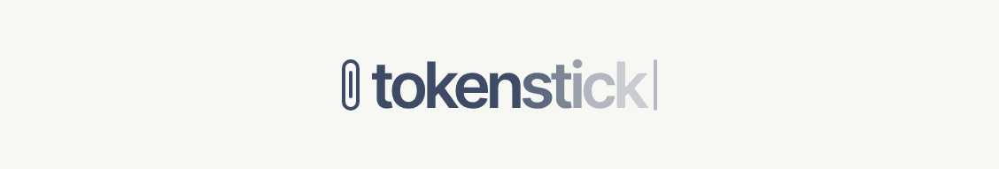
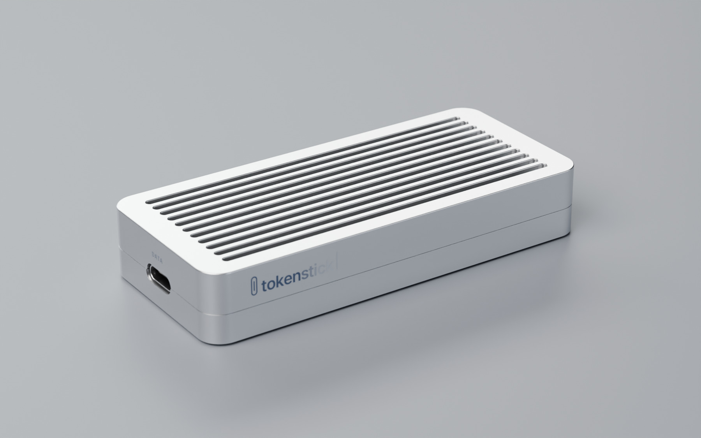
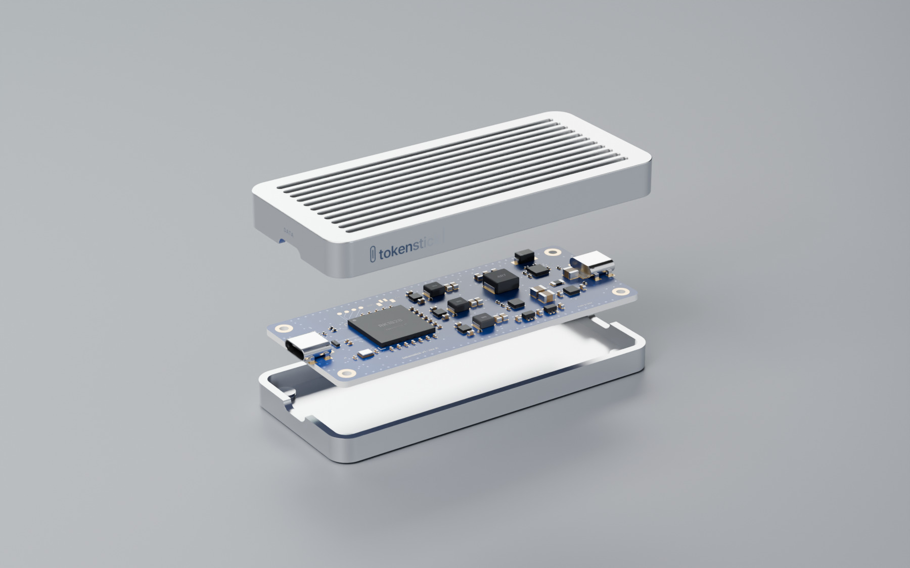

<p align="center">
  
</p>

<h3 align="center">A USB stick that runs LLMs locally</h3>

<p align="center">
  Plug it in, point your tools at a local endpoint, keep your data on your desk.
</p>

<p align="center">
  
</p>

<p align="center">
  <sub>Concept render of the v1 enclosure. Not final hardware.</sub>
</p>

---

## What is TokenStick?

TokenStick is a USB-attached AI accelerator for running large language models on hardware you own. It adds dedicated inference compute to a laptop, mini PC, single-board computer or NAS, without a GPU, a free M.2 slot or a cloud account.

The model runs entirely on the stick. Weights live in the accelerator's own memory, so the host keeps its RAM and CPU for everything else.

## Why

- **Private by default.** Prompts and documents never leave the machine.
- **No GPU required.** Bring local inference to hardware that was never built for it.
- **Works with what you already use.** The goal is a drop-in, OpenAI-compatible local endpoint, so existing clients and tools need no changes.
- **Open.** Hardware design files and host software are intended to be published under open licenses.

## Design targets (v1)

| | |
|---|---|
| Accelerator | Rockchip RK1828 AI coprocessor |
| Compute | 20 TOPS (INT8), mixed precision from INT4 to FP16 |
| Memory | 5 GB in-package DRAM, dedicated to the model |
| Model class | LLMs and VLMs up to roughly 7B parameters |
| Host link | USB 3.0 over USB-C |
| Power | Separate USB-C input, USB Power Delivery |
| Cooling | Passive, aluminum enclosure |
| Use | Home and office |

These are targets for the first revision, not measured results. Benchmarks will be published once prototypes are running.

## Inside the enclosure

<p align="center">
  
</p>

From top to bottom:

- **Finned aluminum lid.** The fins are milled into the lid and a thermal pad couples the RK1828 to it, so the enclosure itself works as the heatsink. Passive cooling is the target; whether it is enough depends on the power budget, which is still open.
- **Board.** A 6-layer PCB of about 85 × 35 mm. The RK1828 sits next to the data port, with the power stages along the rest of the board.
- **Aluminum tray.** Carries the board on standoffs and closes the enclosure.

There is a USB-C port at each end. **DATA** carries USB 3.0 to the host. **PWR** takes a USB Power Delivery supply, because the accelerator needs more power than a standard USB data port provides.

The renders show the intended form and layout. Dimensions, component placement and finish may change before the first prototypes.

## How it works

```
  Your apps  ──►  local API endpoint  ──►  TokenStick runtime  ──►  USB  ──►  TokenStick
 (chat, IDE,       (OpenAI-compatible)        (host service)                 (model + compute)
  agents)
```

1. Plug TokenStick into a USB-C port and connect a USB-C power supply.
2. The host service loads a model onto the stick.
3. Applications talk to a local endpoint, the same way they would talk to a cloud API.

## Repositories

| Repository | What it holds | License |
|---|---|---|
| [tokenstick-hw](https://github.com/TokenStick/tokenstick-hw) | Hardware design files: KiCad schematic and PCB, RK1828 symbol and footprint, design notes, BOM draft | CERN-OHL-S v2 |
| [tokenstick-host](https://github.com/TokenStick/tokenstick-host) | Host software in Rust: core library, `tokenstick` CLI, OpenAI-compatible server and the built-in web UI | Apache-2.0 |
| [.github](https://github.com/TokenStick/.github) | This organization profile | |

**Planned**

- [ ] **tokenstick-models**: model conversion from Hugging Face to RKNN3, quantization recipes and published benchmark results. Opens when the dev kit runs its first benchmarks.
- [ ] **tokenstick-fw**: device firmware packaging, signing and the USB boot and update flow. Opens with the first TokenStick board.
- [ ] **tokenstick-docs**: user documentation and guides. Until then, docs live in the `docs/` folder of each repository.

## Status

TokenStick is in the design phase. Nothing has been built or tested yet.

**Done**

- [x] Architecture and chip selection
- [x] Bill of materials and board floorplan
- [x] RK1828 symbol and footprint (746 balls, generated from the datasheet pin list)
- [x] Schematic for the USB-C data path, the USB PD power input and the 5 V buck
- [x] First board placement: 85 × 35 mm, 6 layers
- [x] USB section routed by hand in KiCad
- [x] Enclosure concept and 3D renders
- [x] Hardware files published in [tokenstick-hw](https://github.com/TokenStick/tokenstick-hw) under CERN-OHL-S v2
- [x] Host software started in [tokenstick-host](https://github.com/TokenStick/tokenstick-host): CLI, OpenAI-compatible server and web UI on a simulated backend

**In progress**

- [ ] Schematic for the RK1828 power rails, clock and reset
- [ ] PCB layout beyond the USB section
- [ ] Power and thermal budget for the enclosure

The power rail design waits on current and sequencing figures from the chip vendor.

**Next**

- [ ] First prototypes and bring-up
- [ ] Host runtime on real RK1828 hardware
- [ ] Published benchmarks
- [ ] Crowdfunding campaign

Details may change as the design moves from paper to hardware.

## Roadmap

- **Prototype:** working board, model loading over USB, first token-per-second numbers.
- **Developer preview:** host runtime for Linux, local API endpoint, documentation.
- **Launch:** crowdfunding campaign and first production batch.
- **Later:** pooling several sticks on one host, more host platforms.

## Get involved

The project is early, and feedback on the design and the use cases is welcome. Design files, firmware and software will be published here as they become ready.

---

<p align="center">
  <sub>TokenStick is an independent open hardware project. Product names mentioned belong to their respective owners.</sub>
</p>
